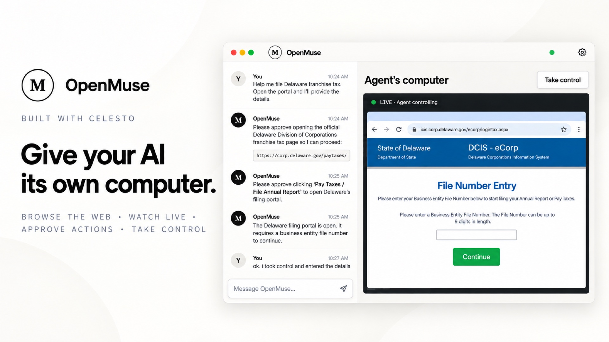

<div align="center">


# Celesto

### Secure, persistent computers for AI agents

[](https://github.com/CelestoAI/celesto/actions/workflows/github-code-scanning/codeql)
[](https://github.com/CelestoAI/celesto/actions/workflows/pytest.yml)
[](https://opensource.org/licenses/Apache-2.0)
[](https://www.python.org/downloads/)

[OpenMuse](#built-with-celesto-openmuse) · [Quickstart](#quickstart) · [Python API](#use-the-python-api) · [Agents and automation](#agents-and-automation) · [Runtimes](#choose-a-runtime) · [Examples](#examples) · [Docs](https://docs.celesto.ai) · [Discord](https://discord.gg/KNb5UkrAmm)

</div>

---

Celesto gives an AI agent its own computer for running code, browsing the web, and using desktop apps. You can run that computer on your machine during development or in Celesto Cloud for remote and production work.

Each computer is a lightweight virtual machine, starts in about 500 ms, and can keep files and state between sessions. Because the agent runs in a separate computer instead of a process on your machine, Celesto provides a stronger boundary for untrusted code.

These docs use one word for each idea. See the [glossary](GLOSSARY.md) for what "computer", "desktop", and "browser session" mean.

## Built with Celesto: OpenMuse

<picture>
  <source media="(prefers-color-scheme: dark)" srcset="./open-muse/banner-dark.png">
  <source media="(prefers-color-scheme: light)" srcset="./open-muse/banner-light.png">
  
</picture>

**OpenMuse is our open-source computer coworker, built end to end on Celesto.** It browses public websites in its own disposable Linux desktop while you watch, approve clicks and form changes, or take control.

[Explore OpenMuse →](./open-muse/README.md)

> OpenMuse is a preview. Clone this repository to run it locally.

## Quickstart

### 1. Install Celesto

On Linux or macOS, this command installs the Celesto CLI and Python SDK, prepares the machine, and checks that it is ready:

```bash
curl -fsSL https://celesto.ai/install.sh | bash
```

<details>
<summary>Manual local setup</summary>

Install Celesto with Python 3.11 or newer, prepare the machine, then check the setup:

```bash
pip install celesto
celesto setup
celesto doctor
```

On macOS, setup uses Homebrew to install [QEMU](https://www.qemu.org/docs/master/system/i386/microvm.html). On Linux, setup may ask for `sudo`.

</details>

### 2. Create a computer

Give the computer a name so later commands can find it:

```bash
celesto computer create --name my-computer
```

`celesto sandbox` remains an equivalent spelling for every `celesto computer` subcommand. See [older names you will still see](GLOSSARY.md#older-names-you-will-still-see).

### 3. Run a command

Everything after `--` runs inside the computer:

```bash
celesto computer exec my-computer -- python --version
```

### 4. Delete the computer

Delete it when you no longer need its files or state:

```bash
celesto computer delete my-computer
```

Use `celesto computer stop my-computer` instead when you want to keep it for later. Restart it with `celesto computer start my-computer`.

Local CLI and Python SDK usage telemetry displays a notice before sending limited
installation and feature counts. PostHog may infer approximate location from the
request IP address. To turn telemetry off, run `celesto config telemetry off`
or set `CELESTO_NO_TELEMETRY=1` in your environment. See the
[CLI reference](docs/reference/cli.md#local-usage-telemetry) and
[privacy policy](https://celesto.ai/legal/privacy-policy).

## Use the Python API

The installer includes the Python SDK. The `with` block creates a local computer when the block starts and deletes it when the block ends:

```python
from celesto import Computer

with Computer() as computer:
    result = computer.run("echo 'Hello from Celesto!'")
    print(result.stdout)
```

### Run in Celesto Cloud

Cloud computers do not require virtualization software on your machine. First, set your API key:

```bash
export CELESTO_API_KEY="your-api-key"
```

Then run the same Python code with the cloud provider:

```python
from celesto import Computer

with Computer(provider="cloud") as computer:
    result = computer.run("echo 'Hello from Celesto Cloud!'")
    print(result.stdout)
```

| Provider | Best for | What your machine needs |
| --- | --- | --- |
| Local | Development, tests, and private workloads on your machine | Local virtualization setup |
| Cloud | Remote tasks, persistent workspaces, and production workloads | Python package and `CELESTO_API_KEY` |

## Agents and automation

Celesto commands print readable output by default. Add `--json` when a script or agent needs stable, machine-readable output. Every JSON response contains `ok`, `command`, `exit_code`, `data`, and `error` fields.

Check the machine before accepting work. `--strict` makes warnings fail the check:

```bash
celesto doctor --strict --json
```

Create a named computer and capture the JSON response:

```bash
celesto computer create --name agent-job --json
```

Run a command without opening an interactive shell:

```bash
celesto computer exec agent-job --json -- python -m pytest
```

Always clean up the computer by its exact name when the job ends:

```bash
celesto computer delete agent-job --json
```

Use unique names for concurrent jobs. Prefer `exec` for automation; reserve `shell`, `ssh`, and `desktop` for interactive work. Commands return a nonzero exit code on failure, and JSON errors include a recovery command when Celesto can provide one.

For a coding agent with its CLI already installed, start a preset directly:

```bash
celesto codex start
```

Celesto also provides presets for Claude Code, Pi, Hermes, OpenCode, and OpenClaw. See the [agent presets guide](docs/guides/agent-presets.md) for credentials, naming, and unattended usage.

## Inspect and connect

Use `celesto computer list` to see computers, `celesto computer logs my-computer` to inspect startup output, or `celesto computer shell my-computer` to open a fast interactive shell.

Add `--follow` to stream logs. Use `celesto computer ssh my-computer` when you need an SSH session. See the [CLI reference](docs/reference/cli.md) for every command and shell completion.

## Choose a runtime

Celesto exposes one default API and focused APIs for browser and desktop work:

| Runtime | Use it when an agent needs | Python API | CLI |
| --- | --- | --- | --- |
| Minimal computer | Commands, code, and files | `Computer()` | `celesto computer` |
| Browser session | Chromium, CDP, screenshots, or a live viewer | `Celesto.browser()` | `celesto browser` |
| Computer with a desktop | A full desktop and multiple GUI apps | `Celesto.computer()` | `celesto computer create --desktop` |
| Windows computer | PowerShell or Windows software | `Celesto(os="windows", ...)` | `celesto computer create --os windows --image PATH` |
| macOS desktop | App or installer tests on Apple Silicon | — | `celesto computer create --os macos` |

Use `Computer` for the common minimal computer path. Use the `Celesto` factories for focused browser and desktop runtimes. Use `Celesto(...)` directly when you need low-level options such as the backend, communication channel, operating system, shared folders, or network policy.

## Core capabilities

| Capability | What it provides |
| --- | --- |
| Fast start | A ready computer in about 500 ms, without an image pull on each start |
| Isolation | Each computer is separate from your machine and from other computers |
| Local or cloud | The same `Computer` API across development and production |
| Persistent state | Files and state that survive across sessions |
| Shared folders | Read-only or writable access to selected folders on your machine |
| Snapshots | Pause and restore memory, disk, and active processes |
| Network policy | Disable outbound access or allow specific IPv4 ranges on Linux with Firecracker |
| Multiple operating systems | Linux, Windows 11, and macOS preview support |

## Browser

Use a browser session when an agent only needs Chromium. Celesto exposes a CDP endpoint for automation and, in visible mode, URLs for live view and screen control.

```python
from celesto import Celesto

with Celesto.browser(headless=False) as browser:
    print(browser.cdp_url)
    print(browser.viewer_url)
    print(browser.display_url)
```

- `cdp_url`: connect Playwright or another CDP client.
- `viewer_url`: watch the browser from another browser.
- `display_url`: connect a VNC client or computer-use agent.

Use `headless=True` when the agent only needs CDP. Start a visible browser from the CLI with:

```bash
celesto browser start --live
```

See [examples/browser_sandbox.py](examples/browser_sandbox.py) for a complete example.

## Computer with a desktop

Use a computer with a desktop when an agent needs to see and use more than a browser. The default image includes Chromium, a terminal, a file manager, and a text editor.

```python
from celesto import Celesto

with Celesto.computer() as computer:
    print(computer.display.viewer_url)
    print(computer.browser.cdp_url)

    computer.files.write("/workspace/task.txt", "Review this file")
    print(computer.run("ls -la /workspace").stdout)
```

The API groups screen access under `computer.display` and Chromium access under `computer.browser`. If Chromium closes while the desktop stays active, call `computer.browser.launch()`.

The first start downloads and verifies the Linux desktop image. Later starts reuse the cached image, so Docker is not required.

```bash
celesto computer create --desktop --name assistant
celesto computer open assistant
celesto computer delete assistant --desktop
```

See the [desktop guide](docs/guides/computers.md) for Python and TypeScript examples.

## Windows computer

Use a Windows computer when an agent must run PowerShell or Windows software. Celesto can boot Windows 11 from a baseline image, upload files, set environment variables, and start multiple computers from the same image.

```python
from celesto import Celesto

with Celesto(
    os="windows",
    image="~/.celesto/images/win11.qcow2",
    ssh_user="celesto",
    ssh_password="celesto",
) as computer:
    print(computer.run("Write-Output 'hello from windows'").stdout)
```

Create an image from a Windows ISO:

```bash
celesto windows build-image \
    --iso ./Win11.iso \
    --virtio-win-iso ./virtio-win.iso \
    --output ~/.celesto/images/win11.qcow2
```

Windows computers need a Linux machine with KVM. Shared folders, network controls, and snapshots work only on Linux computers. See the [Windows guide](docs/guides/windows.md) for image setup and requirements.

## macOS desktop preview

On an Apple Silicon Mac, Celesto can create a temporary macOS desktop for app and installer tests without changes to your main system.

Prepare the reusable local image:

```bash
celesto setup --macos
```

Create and open a desktop:

```bash
celesto computer create --os macos --name test-mac
celesto computer desktop test-mac
```

The first setup downloads macOS from Apple, requires about 50 GB, and takes 20–40 minutes. The image stays on the Mac that created it. Celesto supports at most two macOS computers at once. See the [macOS desktop guide](docs/guides/macos.md) for limits, shared folders, and cleanup.

## Common workflows

### Share a folder from your machine

Give a local computer access to an existing project without a copy step:

```bash
celesto computer create --name my-computer --mount ~/Projects/my-app
celesto computer shell my-computer
ls /workspace
```

Shared folders are read-only by default. The computer can read the source files, but writes under `/workspace` stay inside the computer and do not change the copy on your machine.

Choose a path inside the computer, or share multiple folders:

```bash
celesto computer create \
    --mount ~/Projects/my-app:/code \
    --mount ~/data:/mnt/data
```

Add `--writable-mounts` only when the computer must change the files on your machine:

```bash
celesto computer create \
    --mount ~/Projects/my-app \
    --writable-mounts
```

The flag applies to every shared folder in that command. Do not combine a writable project folder with a folder that must remain unchanged.

The same option exists in Python:

```python
from celesto import Celesto

with Celesto(mounts=["~/Projects/my-app"], writable_mounts=True) as computer:
    computer.run("echo hello > /workspace/from-computer.txt")
```

### Upload one file

Copy a config, script, or small input into a running computer:

```bash
celesto computer file upload my-computer ./prompt.txt /tmp/prompt.txt
```

Or upload a file to a temporary computer from Python:

```python
from celesto import Celesto

with Celesto() as computer:
    computer.upload_file("./prompt.txt", "/tmp/prompt.txt")
```

The destination must be an absolute path inside the computer. Celesto replaces any file that already exists at that path.

### Restrict network access

Computers have internet access by default. On Linux with Firecracker, use `vsock` to keep command and file-transfer access while you disable outbound network access:

```python
from celesto import Celesto

with Celesto(
    backend="firecracker",
    comm_channel="vsock",
    internet_settings={"mode": "off"},
) as computer:
    print(computer.run("echo hello").stdout)
```

Use `mode="restricted"` with `allowed_cidrs` to allow specific IPv4 addresses or ranges. The restricted modes require private network mode and do not support shared folders or exposed ports. Explicit command output and file downloads still work when outbound access is off.

An `allowed_domains` list resolves domains during setup and permits the resulting IP addresses. It does not check the hostname on each connection. DNS servers do not receive automatic access. See the [network guide](docs/guides/networking.md) for supported combinations.

### Start a code agent

Run a supported code agent in its own computer so it can edit and execute code without direct access to your machine:

```bash
celesto codex start
celesto claude start
celesto pi start
celesto hermes start
celesto opencode start
celesto openclaw start --name openclaw-work --no-attach
```

Open the private OpenClaw dashboard after the computer starts:

```bash
celesto openclaw open-ui openclaw-work
```

The first OpenClaw start can take several minutes while Celesto installs its supported Node.js runtime and pinned OpenClaw release. See the [agent presets guide](docs/guides/agent-presets.md) for credentials and dashboard access.

<a href="https://youtu.be/j1qyrTsI0Jw"></a>

## Examples

### Start here

| Goal | Example |
| --- | --- |
| Run code in a computer | [quickstart_sandbox.py](examples/quickstart_sandbox.py) |
| Start a browser session | [browser_sandbox.py](examples/browser_sandbox.py) |
| Pass environment variables | [env_injection.py](examples/env_injection.py) |

### Agent framework integrations

| Framework or task | Example |
| --- | --- |
| OpenAI Agents | [openai_agents_tool.py](examples/agent_tools/openai_agents_tool.py) |
| LangChain | [langchain_tool.py](examples/agent_tools/langchain_tool.py) |
| PydanticAI shell tool | [pydanticai_tool.py](examples/agent_tools/pydanticai_tool.py) |
| PydanticAI computer across turns | [pydanticai_reusable_tool.py](examples/agent_tools/pydanticai_reusable_tool.py) |
| PydanticAI browser automation | [pydanticai_agent_browser.py](examples/agent_tools/pydanticai_agent_browser.py) |
| Computer use | [computer_use_browser.py](examples/agent_tools/computer_use_browser.py) |

Each example includes any extra package command it requires.

## Security

Each computer runs in its own virtual machine, which provides a stronger isolation boundary than process-level containers. Isolation still depends on secure configuration of your machine, the hypervisor, images, credentials, shared folders, and networking.

Celesto trusts a new local computer on its first connection to simplify development. Do not expose computer ports to the public internet without authentication and network controls. Treat writable shared folders, forwarded credentials, and services the computer can reach on your machine as explicit trust decisions.

See [SECURITY.md](SECURITY.md) for the security policy, threat model, and disclosure process.

## Performance

The benchmark suite measures cold start, time to interactive, pause and resume, and snapshot create and restore. It uses the public Python SDK with the native backend for your machine: Firecracker on Linux and QEMU on macOS.

```bash
uv run python scripts/benchmarks/bench.py
```

See the [benchmark guide](scripts/benchmarks/README.md) for flags, output, and metric definitions.

## Contributing

See [CONTRIBUTING.md](CONTRIBUTING.md) to set up a development environment and submit a change. Coding agents should also read [AGENTS.md](AGENTS.md) for repository-specific commands, CLI conventions, release checks, and writing guidelines before editing the project.

## License

Apache 2.0. See [LICENSE](LICENSE) for details.

---

<div align="center">

Built with 🧡 by [Celesto AI](https://celesto.ai)

</div>
